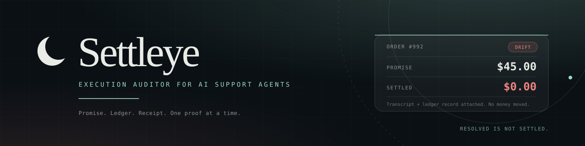

<div align="center">
  
  <h3>Your AI agent promised a refund. Did the money move?</h3>
  <p>
    <a href="https://8-bitrhyon.github.io/settleye/index.html?sample=1"></a>
    <a href="https://youtu.be/rsf70ZVFdz0"></a>
  </p>
  <p>
    
    
    
    
  </p>
</div>

Settleye is the execution auditor for AI support agents. It reads a support transcript, extracts every binding promise, checks it against Stripe or Shopify ledger state, and puts the gap in one exception inbox. One click fixes the shortfall against the test ledger with a signed, idempotent receipt.

Built for the Meta Global AI Developer Hackathon (Indie Developer Track, Push the Frontier).

**Live demo:** https://8-bitrhyon.github.io/settleye/landing.html

## Watch the film

[](https://youtu.be/rsf70ZVFdz0)

Three minutes. One promise. One ledger. One receipt.

## The gap

Your AI agent tells the customer the refund is processed. The ticket closes. The ledger says `$0.00` moved. The agent is not lying. It just never checked.

The industry grades the conversation. The customer waits for the money.

## What it does

1. **Extract the promise.** `meta-models/muse-spark-open-1026` (via Baseten) returns structured promise objects. Every reply passes Pydantic validation. Bad output gets two repairs, then a loud failure instead of a guess.
2. **Gate the binding commitment.** Only binding commitments reach the ledger. Retracted, conditional, superseded, and info-only text never reports drift.
3. **Reconcile the ledger.** Deterministic code diffs each binding refund against settled Stripe or Shopify state: verified, drift, unverifiable, or not binding.
4. **Fix once and prove it.** One click settles the shortfall against the demo's mock ledger through an idempotent service. The receipt is signed, persists append-only, and returns the original receipt on a retry.

```mermaid
flowchart LR
  T[Transcript] --> E[Extract promise]
  E --> G{Binding?}
  G -- No --> N[Not drift]
  G -- Yes --> R[Reconcile ledger]
  R --> D{Drift?}
  D -- No --> V[Verified]
  D -- Yes --> I[Exception inbox]
  I --> F[One-click fix]
  F --> P[Signed receipt]
```

## Proof: measured, labeled, modeled

| Tier | What it proves | Result | Label |
|---|---|---|---|
| **Tier 1** | Live, read-only Shopify dev store | **$44.00 at risk** on test-mode order `#1001` in 4.07 seconds. $6.00 settled of a $50.00 promise. No money moved. One order, not a fleet sample. | Measured |
| **Tier 2** | 12-case labeled eval replay | **12/12 verdicts** correct, 11/12 entities exact, 0/8 binding cases missed, 0/4 non-binding promises drifted. **$285.50 at risk** across 5 drifts. | Measured |
| **Tier 3** | Fleet projection | **$124,328.40 / $1,256,604.96 / $12,557,168.40** in modeled annual exposure protected at 10,000 / 100,000 / 1,000,000 tickets per month. | Modeled |

Tier 3 is a projection from stated assumptions, not a guarantee or a merchant result. The 4.0% execution-failure rate is an assumption, not a merchant measurement. Read the [claim ledger](docs/research/20-claims.md) and the [impact inputs](docs/research/15-impact-report.md).

<details>
<summary>Full fleet table and assumptions</summary>

| Volume tier | Monthly tickets | Annual drifts | Direct exposure | Dispute exposure (4.61x) | Chargeback fees ($128/ea) | Modeled annual exposure protected |
|---|---:|---:|---:|---:|---:|---:|
| **Mid-market** | 10,000 | 336 | $17,640.00 | $81,320.40 | $43,008.00 | **$124,328.40** |
| **Large e-commerce** | 100,000 | 3,396 | $178,290.00 | $821,916.96 | $434,688.00 | **$1,256,604.96** |
| **Global enterprise** | 1,000,000 | 33,936 | $1,781,640.00 | $8,213,360.40 | $4,343,808.00 | **$12,557,168.40** |

Modeled annual exposure protected combines dispute exposure and chargeback fees. Direct exposure is shown separately.

Assumptions: 10.6% refund intent, 66.7% binding commitment, 4.0% execution failure, $52.50 average refund, 4.61x dispute cost, $128 chargeback fee. The 4.0% failure rate is an assumption, not a merchant measurement. The table is a projection. It is not a guarantee or a merchant result.

The pipeline micro-benchmark is about 95,000 to 122,000 transcript audits per second on this machine, p50 about 0.009 ms, over 1,000 canned transcripts and a mock ledger. No model or network calls. Model inference is seconds per transcript, not milliseconds.

</details>

## Try it

### In the browser (30 seconds, no install)

Open the [sample inbox](https://8-bitrhyon.github.io/settleye/index.html?sample=1). It is a static recording of a live audit, not a model call.

1. Click `Issue $45.00 refund`. One `Remediation receipt` appears with valid issuer and merchant signatures.
2. Click `Retry the same fix`. It returns `Already executed. $0.00 additional movement.` with the same idempotency key.
3. Click `Try tamper demo`. Both signatures fail. `Reset` restores both.

Nothing moves and no credentials are required.

### In the terminal (10 seconds, no credentials)

```bash
# 1. Backend tests
(cd backend && uv run pytest)

# 2. Offline daemon sweep (12 tickets, 5 drifts, $285.50 at risk)
(cd backend && uv run python -m app.daemon --dir ../fixtures/eval --ledger mock --replay ../fixtures/eval_live_output.json)

# 3. Pipeline micro-benchmark
python3 bench/fleet_benchmark.py

# 4. Modeled fleet projection
python3 bench/fleet_projection.py
```

Or run the complete verification suite in one command:

```bash
bash tools/judge_audit.sh
```

## How it is built

- **Extraction:** `meta-models/muse-spark-open-1026` via Baseten, pinned by `MODEL_ID`. One call returns promise objects; a second explains a drift in plain English.
- **Validation:** untrusted reply text is stripped, parsed, and validated with Pydantic. Two repairs, then a loud failure. The model never decides whether money moved.
- **Reconciliation:** deterministic code joins each binding promise to Stripe or Shopify ledger state. The ledger is the source of truth.
- **Remediation:** idempotent service keyed by the promise. A retry returns the original receipt. A concurrent duplicate is serialized. A charge ceiling rejects a forged larger promise.
- **Receipts:** Ed25519 issuer and merchant signatures. Both verify in the browser with pinned keys. Change one digit and the signature fails.
- **Daemon:** a batch sweep flags orders promised across several tickets. The nightly path is audit-only unless the ledger is the mock.

| Path | What is there |
|---|---|
| `backend/` | FastAPI app, extraction, ledger adapters, remediation, receipts, tests |
| `frontend/` | Vite + React sample inbox and landing page |
| `film/` | Code-driven 3-minute film, capture scripts, voiceover mux |
| `bench/` | Fleet projection, pipeline benchmark, fine-tune gate results |
| `docs/` | Receipt spec, research, claim ledger, marketing copy |
| `tools/judge_audit.sh` | One-command verification |

## Security and scope

- **Signed receipts:** issuer and merchant signatures cover the exact payload. They prove which pinned keys signed it. They do not independently prove that the ledger is true or that the transcript is authentic.
- **Idempotency:** a retry returns the original receipt and moves `$0.00`. Concurrent duplicates produce one refund. Forged amounts above the original charge are rejected with HTTP 422.
- **Test ledgers only:** the HTTP fix path runs on the mock ledger. Stripe and Shopify write adapters are tested but not wired into the route. No live payments, no real merchant data, and no customer data.
- **Honest limits:** Tier 3 is modeled. SOC 2 is on the roadmap, not available today. The public sample is a test-ledger demo.

## Docs

| Doc | What it covers |
|---|---|
| [`design.md`](design.md) | Architecture, invariants, and key decisions |
| [`docs/receipt-spec.md`](docs/receipt-spec.md) | Signed receipt, key lifecycle, merchant countersignature |
| [`docs/research/12-eval-results.md`](docs/research/12-eval-results.md) | Measured 12-case eval results |
| [`docs/research/15-impact-report.md`](docs/research/15-impact-report.md) | Borrowed impact inputs and qualifiers |
| [`docs/research/19-hf-benchmark.md`](docs/research/19-hf-benchmark.md) | 300 wild transcripts |
| [`docs/research/20-claims.md`](docs/research/20-claims.md) | Claim ledger and scope notes |
| [`docs/research/21-model-comparison.md`](docs/research/21-model-comparison.md) | Muse Spark Open versus the frontier arm |
| [`docs/research/22-free-gate-finetune.md`](docs/research/22-free-gate-finetune.md) | Free-gate negative result |
| [`docs/research/23-shadow-audit.md`](docs/research/23-shadow-audit.md) | 12-case shadow-audit proxy and merchant blocker |
| [`SUBMISSION.md`](SUBMISSION.md) | Hackathon submission, judge paths, and form copy |

<details>
<summary>Full local pipeline (optional, requires a model key)</summary>

1. Copy `backend/.env.example` to `backend/.env` and set `BASETEN_API_KEY`. Test-mode credentials only. Never commit `.env`.
2. Backend:

```bash
cd backend
uv sync
uv run pytest
uv run python -m app.keyring init
uv run uvicorn app.main:app --reload
```

`keyring init` writes a fresh issuer keypair and public registry under `backend/.tmp/`, both gitignored. Without it, remediations still persist but the response carries no signed envelope.

3. Frontend, in a second terminal:

```bash
cd frontend
npm install
npm run dev
```

4. Open http://localhost:5173 and click `Audit transcript`. That calls the model. Without `BASETEN_API_KEY`, `/audit` returns 503 by design.

No-key paths that run offline with zero credentials: `uv run pytest`, `uv run python -m app.daemon --dir ../fixtures/eval --ledger mock --replay ../fixtures/eval_live_output.json`, `python3 bench/fleet_benchmark.py`, `python3 bench/fleet_projection.py`, `python -m app.keyring init` and `list`, the browser sample verifier, `POST /receipt/verify`, `GET /receipt/keys`, and the frontend tests and build. Live daemon execution without `--replay` and `/explain` call the model and require `BASETEN_API_KEY`.

</details>

<details>
<summary>API</summary>

- `POST /audit` takes a transcript and returns promises, results, drifts, totals, and audit provenance.
- `POST /explain` takes one drift and returns a plain-English summary.
- `POST /remediate` takes a drift plus optional audit context and returns an idempotent receipt, with a signed envelope when a key is configured.
- `POST /receipt/verify` verifies an issuer-only or two-party receipt with a pin or the published registry.
- `GET /receipt/keys` returns public issuer key history and lifecycle state.
- `GET /value` returns recovered dollars and avoided disputes.

</details>

<details>
<summary>Shopify dev-store check (read-only)</summary>

The Dev Dashboard app `Settleye Auditor` exchanges its client ID and secret for a 24-hour `shpua_` access token. `token --write` refreshes that token in `.env` without printing it. The live check reads settled refunds for order `#1001`. The daemon replays the $50 fixture and reports $44 at risk. Neither writes money.

```bash
cd backend
uv run python -m app.ledger.token --write
uv run python -m app.ledger.live_check 1001
uv run python -m app.daemon --dir ../fixtures/live --ledger shopify
```

A `shpss_` value is the app secret, not the access token. Use the token command. A custom app's `shpat_` token also works if you prefer that setup.

</details>

## License

MIT. See [LICENSE](LICENSE).

Built for the Meta Global AI Developer Hackathon. Test-mode and dev-store data only.
